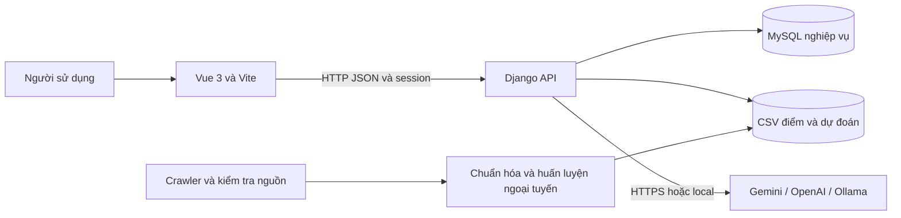
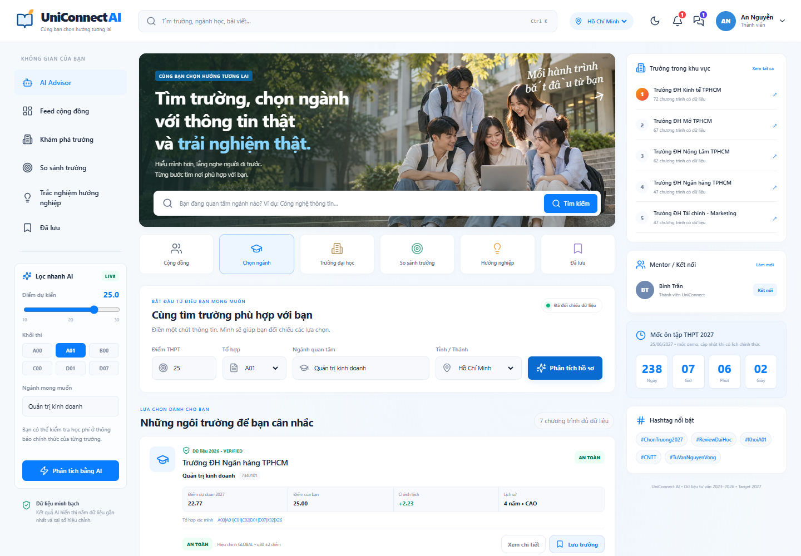
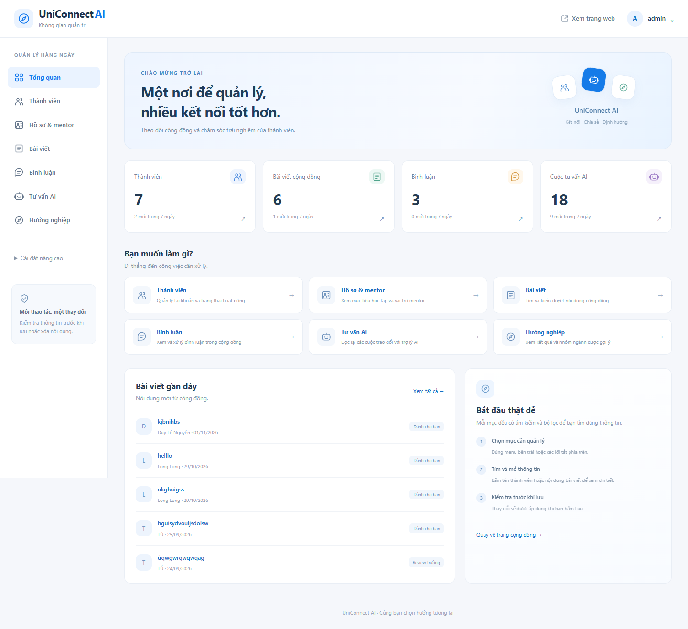
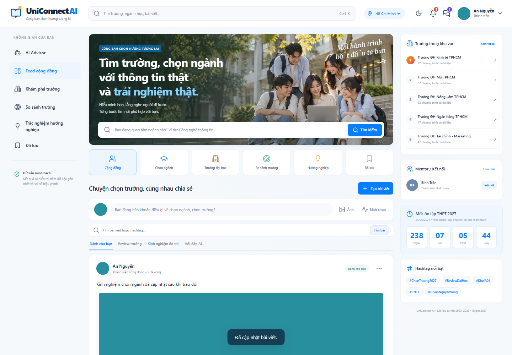

# UniConnect AI — Website tư vấn chọn trường và ngành học

Hệ thống web hỗ trợ tra cứu tuyển sinh, so sánh trường và tư vấn theo điểm thi,
tổ hợp, ngành học, khu vực. Dự án kết hợp **dữ liệu có nguồn**, **dự đoán điểm
bằng hồi quy**, **hội thoại AI**, **hướng nghiệp RIASEC** và **cộng đồng sinh viên**.

**Công nghệ:** Vue 3 · Vite · Django 5.2 · MySQL · pandas · scikit-learn · Gemini / OpenAI / Ollama.

**Báo cáo nộp:** [Mở hoặc tải Baocaodoan.pdf](Baocaodoan.pdf).
Đây là bản báo cáo do sinh viên tự chỉnh sửa và cung cấp cùng mã nguồn.

## Mục lục

- [1. Tổng quan và phạm vi](#tong-quan)
- [2. Kiến trúc hệ thống](#kien-truc)
- [3. Chức năng chính](#chuc-nang)
- [4. Giao diện minh họa](#giao-dien)
- [5. Cấu trúc thư mục](#thu-muc)
- [6. Cài đặt và chạy dự án](#cai-dat)
- [7. Cấu hình AI và email](#cau-hinh-ai)
- [8. Dữ liệu và quy trình huấn luyện](#du-lieu)
- [9. Kiểm thử và đánh giá](#kiem-thu)
- [10. Kịch bản demo](#demo)
- [11. Triển khai và giới hạn](#trien-khai)
- [12. Báo cáo và tài liệu chi tiết](#tai-lieu)

<a id="tong-quan"></a>
## 1. Tổng quan và phạm vi

Thông tin tuyển sinh thường nằm ở nhiều website, bảng HTML, PDF và ảnh. Cùng
một ngành có thể có nhiều chương trình, tổ hợp và phương thức xét tuyển. Dự án
tập trung chuẩn hóa thông tin đó, giữ nguồn và năm áp dụng để người học có thể
tra cứu và xây dựng danh sách lựa chọn theo hồ sơ.

Người dùng chính gồm khách tra cứu, thành viên, mentor cộng đồng và nhân sự
quản trị theo quyền. Phiên bản hiện tại phục vụ dữ liệu lịch sử **2023–2026**
và kết quả **dự đoán 2027**. Dự đoán là thông tin tham khảo, không phải điểm
chính thức hoặc cam kết trúng tuyển.

<a id="kien-truc"></a>
## 2. Kiến trúc hệ thống



- **Frontend:** biểu mẫu, kết quả tra cứu, hồ sơ, hội thoại, cộng đồng; gọi API bằng fetch.
- **Backend:** xác thực session/CSRF, kiểm tra quyền, xử lý tư vấn và quản trị.
- **MySQL:** tài khoản, tương tác, lịch sử AI, hướng nghiệp, đợt dữ liệu nhập qua admin.
- **CSV:** lịch sử điểm chuẩn hóa, metadata, kết quả dự đoán tính sẵn.
- **Crawler và training:** chạy theo lô; không cào hoặc huấn luyện lại trong mỗi yêu cầu web.

MySQL và CSV có vai trò riêng. Dữ liệu điểm chưa được chuyển toàn bộ thành bảng
SQL. Điểm nhập từ admin được duyệt và ghép vào tra cứu theo phương thức, chưa
tự đưa vào tập huấn luyện. Lược đồ MySQL hiện có **27 bảng, 33 khóa ngoại vật lý**.

<a id="chuc-nang"></a>
## 3. Chức năng chính

| Nhóm | Nội dung đã triển khai |
|---|---|
| Tài khoản | Đăng ký, đăng nhập, hồ sơ, ảnh đại diện, khôi phục mật khẩu khi có SMTP |
| Tra cứu tuyển sinh | Tìm trường/ngành, lịch sử điểm, nguồn, phương thức, so sánh và lưu trường |
| Tư vấn theo hồ sơ | Lọc điểm, tổ hợp, ngành, khu vực; phân biệt kết quả chính và nhóm cần xác minh |
| Hội thoại AI | Tra điểm, tư vấn tiếp nối, so sánh, giải thích sai số và gợi ý nguyện vọng |
| Hướng nghiệp | Bộ 24 câu nội bộ theo RIASEC, tính nhóm sở thích và lưu kết quả |
| Cộng đồng | Bài viết, ảnh, bình luận, lượt thích, lưu bài và bình chọn |
| Kết nối | Theo dõi, thông báo và tin nhắn trực tiếp |
| Quản trị | Thành viên, nội dung, lịch sử tư vấn, nhập CSV, đối chiếu, công bố và thu hồi |
| Vận hành | Health check, giới hạn yêu cầu, sao lưu và kiểm tra khôi phục |

Quản trị viên dùng **cùng form đăng nhập** với thành viên. Tài khoản staff được
phân luồng vào admin; quyền cụ thể quyết định thao tác được phép. Vai trò mentor
không tự cấp quyền quản trị.

<a id="giao-dien"></a>
## 4. Giao diện minh họa

Ảnh lấy từ các kịch bản kiểm tra giao diện; nội dung tài khoản/bài viết trong ảnh
là dữ liệu thử, không phải một khảo sát người dùng.

### Trang chính và tư vấn



<details>
<summary>Xem giao diện quản trị và cộng đồng</summary>

**Tổng quan quản trị**



**Cộng đồng trên máy tính**



</details>

<a id="thu-muc"></a>
## 5. Cấu trúc thư mục

```text
DoAnAI/
├── README.md                  # Tổng quan, cài đặt, demo và tài liệu
├── Baocaodoan.pdf              # Báo cáo sinh viên đã chỉnh sửa
├── .env.example               # Mẫu cấu hình, không chứa mật khẩu thật
├── requirements-web.txt       # Phụ thuộc phục vụ web
├── requirements-training.txt  # Phụ thuộc crawler và huấn luyện
├── frontend/                  # Vue, component, CSS, dịch vụ gọi API
├── backend/                   # Django apps, migrations, API, admin và tests
│   ├── accounts/              # Xác thực, hồ sơ và upload
│   ├── catalog/               # Trường, dữ liệu công bố và trường đã lưu
│   ├── ai_api/                # Tư vấn hồ sơ
│   ├── ai_chat/               # Hội thoại, provider và bằng chứng
│   ├── career/                # Hướng nghiệp
│   ├── social/                # Bài viết, tương tác, tin nhắn
│   ├── connections/           # Theo dõi và kết nối
│   └── config/                # Cấu hình, health, giới hạn và sao lưu
├── ai/                        # Chuẩn hóa, mô hình, tư vấn và QA
├── scraper/                   # Tải nguồn, bộ nhập và kiểm tra dữ liệu
├── data/
│   ├── dataset/               # Tập sạch, metadata, dự đoán và thống kê
│   ├── processed/             # Đầu vào đã xử lý theo năm
│   ├── raw/                   # Nguồn và báo cáo audit được đưa vào Git
│   ├── verified/              # Thông tin nguồn đã đối chiếu
│   └── qa/                    # Bộ QA 250 mẫu
├── docs/                      # Hướng dẫn, sơ đồ, ảnh và bằng chứng kiểm tra
└── deploy/                    # Cấu hình Nginx mẫu
```

Các cache PDF/OCR dung lượng lớn ở `data/raw/documents/` và
`data/raw/primary_recovery_2023/2024/2026` được giữ trên máy dữ liệu, không đưa
lên GitHub. Tập CSV phục vụ, dữ liệu xử lý, mô hình, nguồn bổ sung và mã crawler
được bàn giao trong repository. Chạy lại toàn bộ pipeline OCR gốc cần bổ sung
các cache nguồn tương ứng hoặc tải lại nguồn; chạy web không cần các cache này.
Ba snapshot HTML chứa cấu hình có dạng khóa của website bên thứ ba cũng được
giữ local theo `.gitignore`, nên kiểm toán đầy đủ những nguồn đó cần bản gốc.

<a id="cai-dat"></a>
## 6. Cài đặt và chạy dự án

### 6.1 Yêu cầu

- Python **3.11** cho môi trường ứng dụng đã kiểm tra.
- Node.js **18.x, 20.x hoặc 22+** và npm, theo yêu cầu Vite 6 trong dự án.
- MySQL **8.x** đang hoạt động; Git để tải mã nguồn.
- Kết nối Internet và key hợp lệ nếu dùng dịch vụ AI cloud.

Các lệnh dưới đây chạy từ **thư mục gốc** dự án trên Windows PowerShell.

### 6.2 Tải mã nguồn và tạo môi trường

```powershell
git clone https://github.com/phamtuan11022021-beep/DoAnAI.git
Set-Location DoAnAI
python -m venv .venv
.venv/Scripts/python.exe -m pip install -r requirements-web.txt
Copy-Item .env.example .env
```

Chỉ chép mẫu ở lần đầu; nếu đã có `.env`, giữ cấu hình riêng của bạn. File này
được Git bỏ qua và không được đưa lên repository.

### 6.3 Cấu hình MySQL và môi trường local

Tạo database `uniconnect_ai` với charset `utf8mb4` và tài khoản được cấp quyền
trên database đó, hoặc dùng database do hosting cấp. Điền `.env`:

```dotenv
DB_ENGINE=mysql
MYSQL_HOST=127.0.0.1
MYSQL_PORT=3306
MYSQL_DATABASE=uniconnect_ai
MYSQL_USER=TAI_KHOAN_MYSQL_CUA_BAN
MYSQL_PASSWORD=MAT_KHAU_MYSQL_CUA_BAN
DJANGO_DEBUG=true
DJANGO_ALLOWED_HOSTS=localhost,127.0.0.1
DJANGO_SECRET_KEY=CHUOI_NGAU_NHIEN_RIENG_CUA_BAN
```

Giá trị trên là **placeholder**, không phải tài khoản hoặc mật khẩu dùng sẵn.
Nếu tài khoản có quyền tạo database, lệnh `backend/manage.py init_mysql` có thể
tạo database khi chưa có. Không cần lệnh này khi database đã tồn tại.

```powershell
.venv/Scripts/python.exe -X utf8 backend/manage.py migrate
.venv/Scripts/python.exe -X utf8 backend/manage.py setup_admin_roles
.venv/Scripts/python.exe -X utf8 backend/manage.py createsuperuser
.venv/Scripts/python.exe -X utf8 backend/manage.py runserver 127.0.0.1:8000
```

Migrations tạo cấu trúc database mới; repository không chứa database tài khoản
cá nhân. Tự tạo superuser khi cài trên máy mới. Lệnh tạo nhóm không tự gán quyền
cho thành viên. Không có mật khẩu admin mặc định trong mã nguồn.

### 6.4 Chạy frontend ở terminal thứ hai

```powershell
Set-Location frontend
npm.cmd ci
npm.cmd run dev -- --host 127.0.0.1
```

| Địa chỉ | Chức năng |
|---|---|
| http://127.0.0.1:5173 | Giao diện web |
| http://127.0.0.1:5173/admin/ | Khu vực quản trị qua Vite proxy |
| http://127.0.0.1:8000/api/health/ | Kiểm tra database và tập dữ liệu phục vụ |

Giữ cả hai terminal hoạt động. API, admin và media được proxy từ Vite tới
backend trong môi trường phát triển.

<a id="cau-hinh-ai"></a>
## 7. Cấu hình AI và email

Chọn provider rõ ràng trong `.env`, ví dụ với Gemini:

```dotenv
CHAT_PROVIDER=gemini
GEMINI_API_KEY=KEY_CUA_BAN
GEMINI_MODEL=MODEL_TAI_KHOAN_DUOC_CAP_QUYEN
GEMINI_TIMEOUT=60
GEMINI_MAX_OUTPUT_TOKENS=2048
```

Model có thể cấu hình; các tên mẫu của dự án nằm trong `.env.example`.
Với OpenAI dùng `CHAT_PROVIDER=openai` cùng `OPENAI_API_KEY`, `OPENAI_MODEL`;
với Ollama dùng `CHAT_PROVIDER=ollama`, `OLLAMA_BASE_URL`, `OLLAMA_MODEL` và tải
model trên máy chạy Ollama. Khởi động lại backend sau khi đổi cấu hình.

```powershell
.venv/Scripts/python.exe -X utf8 backend/manage.py check_chat --diagnose
.venv/Scripts/python.exe -X utf8 backend/manage.py check_chat --admissions
```

Các lệnh này có thể gọi dịch vụ thật và tiêu thụ hạn mức API. Khi provider lỗi,
dịch vụ có thể trả bằng chứng tra cứu nội bộ trong những trường hợp hỗ trợ;
điều đó không đồng nghĩa mô hình hội thoại đang hoạt động. Key chỉ đặt ở backend.

Khôi phục mật khẩu cần cấu hình SMTP: `EMAIL_HOST`, `EMAIL_PORT`,
`EMAIL_HOST_USER`, `EMAIL_HOST_PASSWORD`, `EMAIL_USE_TLS`, `DEFAULT_FROM_EMAIL`.
Khi chưa có SMTP, giao diện báo dịch vụ chưa sẵn sàng.

<a id="du-lieu"></a>
## 8. Dữ liệu và quy trình huấn luyện

### 8.1 Quy mô dữ liệu

Số liệu tại mốc rà soát **08/11/2026**, được lưu trong
[`coverage_summary.json`](data/dataset/coverage_summary.json):

| Chỉ tiêu | Số lượng |
|---|---:|
| Bản ghi chương trình–năm sạch | 18.746 |
| Khóa trường | 266 |
| Chương trình phân biệt | 7.517 |
| Chương trình đủ bốn năm | 2.406 |
| Chương trình có ít nhất hai năm | 5.161 |

Đây không phải độ phủ toàn bộ tuyển sinh Việt Nam. Metadata địa điểm có 50 dòng;
407 dòng điểm theo phương thức được giữ ở tập tra cứu riêng. Không cộng chúng
vào số dòng tập THPT sạch hoặc tự chuyển các thang điểm khác về thang 30.

### 8.2 Pipeline và thực nghiệm

Nguồn → lưu bằng chứng → xác minh trường/năm/phương thức → chuẩn hóa → cách ly
xung đột → tạo đặc trưng lịch sử → huấn luyện/kiểm định → xuất dự đoán CSV.

Phương pháp học máy được so sánh gồm Ridge, RandomForest và GradientBoosting,
cùng các baseline điểm gần nhất và xu hướng. Chia tập theo năm mục tiêu để
không lấy dữ liệu tương lai làm đặc trưng. Phương pháp phục vụ hiện tại là
**Baseline_LastScore**, có MAE khoảng **1,2280 điểm** trên **3.776 mẫu năm 2026**.
Các mức An toàn / Phù hợp / Thử sức là nhãn tham khảo, không phải xác suất đỗ.

Xem [bảng chỉ số kiểm định](data/dataset/cutoff_model_metrics_2026_holdout.csv).

Muốn tái tạo dữ liệu/mô hình, cài phụ thuộc training trong môi trường riêng:

```powershell
.venv/Scripts/python.exe -m pip install -r requirements-training.txt
.venv/Scripts/python.exe -X utf8 ai/prepare_dataset_4years_FINAL.py
.venv/Scripts/python.exe -X utf8 ai/train_cutoff_models.py
.venv/Scripts/python.exe -X utf8 ai/audit_data.py
.venv/Scripts/python.exe -X utf8 ai/build_qa_dataset.py
```

Các lệnh này ghi lại đầu ra; chỉ chạy khi chủ động tái tạo, không cần chạy để
mở web. Hướng dẫn cào và kiểm tra nguồn ở
[Quản lý dữ liệu tuyển sinh](docs/QUAN_LY_DU_LIEU_TUYEN_SINH.md).
Bộ QA **250 mẫu** là tài sản kiểm tra, không phải mô hình chatbot đã fine-tune.

<a id="kiem-thu"></a>
## 9. Kiểm thử và đánh giá

Chạy từ thư mục gốc:

```powershell
.venv/Scripts/python.exe -X utf8 backend/manage.py check
.venv/Scripts/python.exe -X utf8 backend/manage.py test accounts social ai_api ai_chat config catalog --noinput
.venv/Scripts/python.exe -X utf8 -m unittest discover -s scraper -p 'test_*.py'
.venv/Scripts/python.exe -X utf8 ai/build_qa_dataset.py --check
.venv/Scripts/python.exe -X utf8 backend/manage.py evaluate_admissions
```

Tài khoản MySQL chạy test cần quyền tạo/xóa database kiểm thử riêng; không cấp
quyền này cho tài khoản production nếu không cần. Có thể đặt `DB_ENGINE=sqlite`
cho một lượt kiểm thử cô lập. Tests provider dùng mock, không yêu cầu API key thật.
Thêm `--live` cho `evaluate_admissions` sẽ gọi dịch vụ thật và có thể phát sinh phí.

Build frontend:

```powershell
Set-Location frontend
npm.cmd run build
```

Bằng chứng rà soát trước bàn giao ghi nhận **83 kiểm thử backend**, **20 kiểm thử
crawler**, kiểm tra **250 mẫu QA**, build frontend và một kịch bản trình duyệt
tích hợp đạt. Phạm vi trình duyệt gồm màn hình 1440px và 390px; chưa phải thử tải
hoặc kiểm thử toàn bộ mọi đường đi. Chi tiết tại
[Rà soát trước khi nộp](docs/RA_SOAT_TRUOC_KHI_NOP_20261108.md).

Kiểm tra lại bộ mã nguồn chuẩn bị đưa lên GitHub ngày **12/11/2026** trên
SQLite cô lập: 83 bài backend được phát hiện, **82 đạt và 1 bài MySQL được bỏ qua**;
20 bài crawler và kiểm tra 250 mẫu QA đạt. Kết quả này không thay thế lượt
kiểm thử riêng trên MySQL của môi trường triển khai.

<a id="demo"></a>
## 10. Kịch bản demo khoảng 8–10 phút

1. Chạy MySQL, backend và frontend; mở trang chính.
2. Tạo/đăng nhập tài khoản, cập nhật hồ sơ.
3. Tìm trường/ngành, mở lịch sử điểm và nguồn; so sánh, lưu trường.
4. Thử hồ sơ **23 điểm, A00, mã ngành 7510303, Nghệ An**; phân biệt điểm thực tế
   với dự đoán 2027 và nhãn tư vấn.
5. Hỏi AI về kết quả vừa xem, đổi một điều kiện; quan sát context và bằng chứng.
6. Làm trắc nghiệm RIASEC; đăng bài hoặc bình luận/bình chọn.
7. Đăng nhập staff từ form chung; mở admin và trình bày luồng nhập CSV → đối chiếu
   → công bố → thu hồi. Dùng dữ liệu thử đã chuẩn bị, không sửa nguồn chưa kiểm tra.
8. Trình bày kiến trúc, mô hình, sai số và giới hạn của sản phẩm.

<a id="trien-khai"></a>
## 11. Triển khai và giới hạn

**Web demo:** [https://uniconnect-ai.onrender.com](https://uniconnect-ai.onrender.com)
— Render Free, TiDB Cloud Starter tại Singapore, hạn mức database 0 USD/tháng.
Ngày 13/11/2026 đã kiểm tra HTTPS, trang chủ/assets, health check, đăng nhập,
trang quản trị, danh sách trường, gợi ý theo điểm và chat tra cứu trên web thật.
Database cloud có 27 bảng, được khởi tạo bằng migrations; tài khoản và dữ liệu
cá nhân trên máy không tự sao chép lên cloud. Chat hiện dùng tra cứu dữ liệu nội
bộ, chưa cấu hình API key Gemini/OpenAI trên hosting. SMTP cũng chưa được bật.

Đã bổ sung `Dockerfile`, `render.yaml` cho **Render Free + TiDB Cloud Starter**:
build Vue cùng Django, phục vụ static bằng WhiteNoise và kết nối TiDB qua TLS.
Giữ hạn mức TiDB **0 USD/tháng**; đặt mật khẩu/API key trong Render Environment.
Hướng dẫn nằm trong [Triển khai và sao lưu](docs/TRIEN_KHAI_VA_SAO_LUU.md#render-free-và-tidb-cloud-starter).
Ảnh tải lên đĩa Render Free có thể mất sau restart/deploy; cần kho ảnh ngoài để
lưu bền vững. Gói Free có thể ngủ khi ít truy cập, lần mở đầu cần chờ khởi động.

Hệ thống chưa có đánh giá hội thoại độc lập diện rộng, khảo sát khả dụng hoặc
thử tải. RIASEC là bộ câu hỏi nội bộ phục vụ định hướng, chưa được kiểm định
tâm lý như công cụ chuẩn hóa. Dự đoán 2027 chưa được kiểm chứng bằng điểm thực tế.

Repository không chứa `.env`, database cá nhân, ảnh người dùng, backups, môi
trường ảo, `node_modules` hoặc file build/cache. Cài máy mới bằng migrations và
tài khoản mới. Các ảnh minh họa trong docs là tư liệu kiểm thử.

<a id="tai-lieu"></a>
## 12. Báo cáo và tài liệu chi tiết

| Tài liệu | Nội dung |
|---|---|
| [Baocaodoan.pdf](Baocaodoan.pdf) | Báo cáo sinh viên đã tự chỉnh sửa để nộp |
| [Giải thích MySQL](docs/GIAI_THICH_CAC_BANG_MYSQL.md) | 27 bảng, quan hệ và truy vấn mẫu |
| [DDL MySQL](docs/bao_cao/so_do/schema_mysql.sql) | Cấu trúc bảng, không có dữ liệu tài khoản |
| [ERD đầy đủ](docs/bao_cao/so_do/erd_mysql_day_du.mmd) | Sơ đồ vật lý Mermaid |
| [Hướng dẫn quản trị](docs/QUAN_TRI_DE_SU_DUNG.md) | Thao tác hằng ngày và phân quyền |
| [Quản lý dữ liệu](docs/QUAN_LY_DU_LIEU_TUYEN_SINH.md) | Nhập/duyệt, cào và kiểm tra nguồn |
| [Triển khai và sao lưu](docs/TRIEN_KHAI_VA_SAO_LUU.md) | MySQL, AI, SMTP, production, backup/restore |
| [Đợt dữ liệu ngày 08/11](docs/BO_SUNG_DU_LIEU_20261108.md) | Bằng chứng và giới hạn bổ sung dữ liệu |

Các công cụ tạo báo cáo tự động cũ ở `docs/bao_cao/` được giữ làm tài liệu kỹ thuật;
**bản báo cáo nộp chính là PDF ở đầu repository**, không phải bản sinh tự động.
