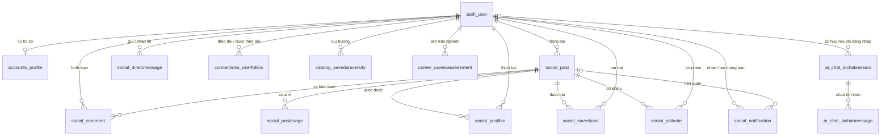

# Giải thích các bảng MySQL của UniConnect AI

Tài liệu đối chiếu với models Django và cấu trúc thực tế của database
`uniconnect_ai` cập nhật ngày **06/11/2026**. Database hiện có **27 bảng**, gồm **15 bảng
nghiệp vụ**, **10 bảng hệ thống Django** và **2 bảng hỗ trợ vận hành**. Các ví dụ dưới đây không chứa
mật khẩu hoặc thông tin đăng nhập của dự án.

## 1. Cách đọc tài liệu

| Thuật ngữ | Ý nghĩa |
|---|---|
| Bảng (table) | Nơi lưu các bản ghi cùng loại, ví dụ tài khoản hoặc bài viết. |
| Cột (column) | Một thuộc tính của bản ghi, ví dụ `username`. |
| Bản ghi (row) | Một dòng dữ liệu; một tài khoản là một bản ghi trong `auth_user`. |
| PK — khóa chính | Định danh duy nhất một bản ghi. Phần lớn bảng dùng `id`; `django_session` dùng `session_key`. |
| FK — khóa ngoại | Tham chiếu khóa chính của bảng khác. Ví dụ `social_post.author_id` tham chiếu `auth_user.id`. |
| UNIQUE | Giá trị hoặc tổ hợp giá trị không được trùng nhau. |
| NULL | Không có giá trị. Khác chuỗi rỗng `''`, số `0` và danh sách JSON rỗng `[]`. |
| 1–N | Một bản ghi có thể liên kết nhiều bản ghi khác: một người có nhiều bài viết. |
| N–N | Nhiều bản ghi ở hai phía có thể liên kết nhau; thường cần bảng trung gian. |

Kiểu dữ liệu trong tài liệu là kiểu **thực tế trên MySQL**:

| Kiểu | Cách hiểu |
|---|---|
| `int`, `bigint` | Số nguyên; `bigint` có phạm vi lớn hơn. Các cột `id` hiện là số tự tăng. |
| `varchar(n)` | Chuỗi tối đa `n` ký tự. |
| `longtext` | Văn bản dài. Giới hạn nội dung của ứng dụng được giải thích riêng. |
| `tinyint(1)` | Django dùng cho boolean: `0` là sai, `1` là đúng. |
| `smallint unsigned` | Số nguyên nhỏ không âm. |
| `decimal(4,2)` | Số có tối đa 4 chữ số, trong đó 2 chữ số sau dấu thập phân. |
| `datetime(6)` | Ngày giờ có phần giây chính xác tới microsecond. |
| `json` | Đối tượng hoặc danh sách JSON. |

**Quy ước:** cột không ghi “cho phép NULL” là cột không nhận SQL `NULL`.
Một số cột chuỗi vẫn được để trống bằng `''` theo model. Giá trị mặc định như
`student`, `False`, `[]`, `{}` và thời gian tự điền là hành vi của Django;
không nên hiểu rằng MySQL tự điền toàn bộ các giá trị này khi chạy `INSERT` tay.

## 2. Danh sách tổng quan 27 bảng

| STT | Bảng | Nhóm | Dùng để lưu |
|---|---|---|---|
| 1 | `auth_user` | Django | Tài khoản và các cờ quyền truy cập. |
| 2 | `accounts_profile` | Nghiệp vụ | Hồ sơ, mentor, điểm và mục tiêu học tập. |
| 3 | `auth_group` | Django | Nhóm quyền quản trị. |
| 4 | `auth_permission` | Django | Từng quyền xem, thêm, sửa, xóa. |
| 5 | `auth_user_groups` | Django | Người dùng thuộc những nhóm nào. |
| 6 | `auth_group_permissions` | Django | Nhóm được cấp những quyền nào. |
| 7 | `auth_user_user_permissions` | Django | Quyền cấp trực tiếp cho người dùng. |
| 8 | `social_post` | Nghiệp vụ | Bài viết cộng đồng và các lựa chọn bình chọn. |
| 9 | `social_comment` | Nghiệp vụ | Bình luận bài viết. |
| 10 | `social_postimage` | Nghiệp vụ | Đường dẫn ảnh đính kèm bài viết. |
| 11 | `social_postlike` | Nghiệp vụ | Lượt thích bài viết. |
| 12 | `social_savedpost` | Nghiệp vụ | Bài viết được người dùng lưu. |
| 13 | `social_pollvote` | Nghiệp vụ | Lựa chọn bình chọn của từng người. |
| 14 | `social_notification` | Nghiệp vụ | Thông báo thích, bình luận, kết nối. |
| 15 | `social_directmessage` | Nghiệp vụ | Tin nhắn trực tiếp giữa hai người dùng. |
| 16 | `connections_userfollow` | Nghiệp vụ | Quan hệ theo dõi/kết nối. |
| 17 | `catalog_saveduniversity` | Nghiệp vụ | Trường đại học được người dùng lưu. |
| 18 | `career_careerassessment` | Nghiệp vụ | Lịch sử trắc nghiệm hướng nghiệp RIASEC. |
| 19 | `ai_chat_aichatsession` | Nghiệp vụ | Các cuộc hội thoại với AI. |
| 20 | `ai_chat_aichatmessage` | Nghiệp vụ | Tin nhắn trong từng cuộc hội thoại AI. |
| 21 | `django_content_type` | Django | Danh mục các model phục vụ phân quyền và quản trị. |
| 22 | `django_admin_log` | Django | Nhật ký thao tác trong Django Admin. |
| 23 | `django_session` | Django | Phiên đăng nhập phía máy chủ. |
| 24 | `django_migrations` | Django | Những migrations đã được áp dụng. |
| 25 | `catalog_admissionrelease` | Nghiệp vụ | Các đợt dữ liệu tuyển sinh: chờ duyệt, công bố hoặc thu hồi. |
| 26 | `catalog_admissionreleaselock` | Vận hành | Khóa phối hợp các thao tác duyệt đồng thời. |
| 27 | `config_requestbucket` | Vận hành | Bộ đếm giới hạn yêu cầu đăng nhập, đăng ký và chat. |

Tên bảng thường theo dạng `tên_app_tên_model`. Ví dụ model `Post` trong app
`social` tạo bảng `social_post`. Tên cột FK thường thêm `_id`: thuộc tính
`author` trong Python tương ứng cột `author_id` trong MySQL.

## 3. Tài khoản, hồ sơ và phân quyền

### 3.1. `auth_user` — Tài khoản đăng nhập

Đây là bảng trung tâm. Bài viết, hồ sơ, tin nhắn và lịch sử hướng nghiệp đều
tham chiếu người dùng trong bảng này.

| Cột | Kiểu | Ý nghĩa |
|---|---|---|
| `id` | `int` | PK của tài khoản. |
| `username` | `varchar(150)` | Tên đăng nhập, UNIQUE. Thành viên đăng ký bằng email thường có `username` chính là email; tài khoản quản trị có thể dùng tên như `admin`. |
| `password` | `varchar(128)` | Mật khẩu đã băm theo định dạng Django, không phải mật khẩu gốc. |
| `first_name` | `varchar(150)` | Phần tên; form đăng ký hiện ghi họ tên người dùng vào trường này. |
| `last_name` | `varchar(150)` | Phần họ bổ sung theo model User, có thể là chuỗi rỗng. |
| `email` | `varchar(254)` | Email liên hệ; cột này không có UNIQUE riêng ở database. |
| `is_active` | `tinyint(1)` | Tài khoản được phép hoạt động hay đã bị vô hiệu hóa. |
| `is_staff` | `tinyint(1)` | Cho phép vào Django Admin khi tài khoản đang hoạt động. |
| `is_superuser` | `tinyint(1)` | Tài khoản có toàn bộ quyền theo cơ chế phân quyền Django khi đang hoạt động. |
| `last_login` | `datetime(6)` | Lần đăng nhập gần nhất; cho phép NULL. |
| `date_joined` | `datetime(6)` | Thời điểm tạo tài khoản. |

Ứng dụng hiện xác thực email/tên đăng nhập qua form chung. Đăng nhập thành công
bằng tài khoản staff sẽ chuyển tới `/admin/`; thành viên thường ở trang chính.
`is_staff` cho phép vào giao diện quản trị, còn khả năng xem/sửa từng mục phụ
thuộc nhóm quyền hoặc quyền cấp trực tiếp. Đăng ký công khai không tự cấp staff.

**Lưu ý về dữ liệu:** email được kiểm tra trùng trong luồng đăng ký của backend;
điều này khác với một UNIQUE constraint trên cột `email` của MySQL.

### 3.2. `accounts_profile` — Hồ sơ và mục tiêu tư vấn

| Cột | Kiểu | Ý nghĩa |
|---|---|---|
| `id` | `bigint` | PK của hồ sơ. |
| `user_id` | `int` | FK tới `auth_user.id`, đồng thời UNIQUE. |
| `role` | `varchar(20)` | `student` hoặc `mentor`; Django mặc định `student`. |
| `expected_score` | `decimal(4,2)` | Điểm dự kiến, ví dụ `25.50`; cho phép NULL khi chưa nhập. |
| `target_combination` | `varchar(10)` | Tổ hợp mục tiêu, ví dụ `A00`, `A01`. |
| `target_major` | `varchar(200)` | Ngành người dùng quan tâm. |
| `city` | `varchar(120)` | Tỉnh/thành phố mong muốn. |
| `bio` | `varchar(300)` | Giới thiệu ngắn. |
| `avatar` | `varchar(100)` | Đường dẫn tương đối ảnh đại diện, ví dụ `avatars/ten-anh.jpg`. |
| `created_at` | `datetime(6)` | Lúc tạo hồ sơ. |
| `updated_at` | `datetime(6)` | Lần lưu cập nhật hồ sơ gần nhất qua Django. |

Quan hệ **một tài khoản có tối đa một hồ sơ**, vì `user_id` là UNIQUE. Hồ sơ
được tạo trong các luồng đăng ký/đọc thông tin tài khoản của ứng dụng; việc tạo
một dòng User trực tiếp không tự bảo đảm đã có dòng Profile.

**Mentor khác admin:** `role='mentor'` là vai trò nghiệp vụ, không tự cấp quyền
quản trị. Quyền quản trị nằm ở `auth_user` và các bảng phân quyền.
Giá trị `decimal(4,2)` cũng không tự giới hạn điểm về thang 30; giới hạn hợp lệ
cần được kiểm tra ở ứng dụng.

### 3.3. `auth_group` — Nhóm quyền

| Cột | Kiểu | Ý nghĩa |
|---|---|---|
| `id` | `int` | PK của nhóm. |
| `name` | `varchar(150)` | Tên nhóm, UNIQUE. |

Dự án đã có nhóm **Kiểm duyệt cộng đồng** và **Theo dõi tư vấn**. Tạo nhóm không
đồng nghĩa mọi người dùng được cấp quyền: cần gán người vào nhóm, đồng thời bật
staff nếu muốn người đó vào Admin.

### 3.4. `auth_permission` — Danh mục quyền

| Cột | Kiểu | Ý nghĩa |
|---|---|---|
| `id` | `int` | PK của quyền. |
| `name` | `varchar(255)` | Tên mô tả quyền. |
| `content_type_id` | `int` | FK tới `django_content_type.id`, chỉ model được áp dụng quyền. |
| `codename` | `varchar(100)` | Mã quyền, ví dụ `view_post`, `change_post`, `delete_post`. |

Cặp `(content_type_id, codename)` là UNIQUE. Quyền hoàn chỉnh trong code có
dạng `social.view_post`: `social` là app, `view_post` là codename.

### 3.5. `auth_user_groups` — Người dùng thuộc nhóm nào

| Cột | Kiểu | Ý nghĩa |
|---|---|---|
| `id` | `bigint` | PK của bản ghi liên kết. |
| `user_id` | `int` | FK tới `auth_user.id`. |
| `group_id` | `int` | FK tới `auth_group.id`. |

Đây là bảng trung gian N–N. Một người có nhiều nhóm, một nhóm có nhiều người.
Cặp `(user_id, group_id)` là UNIQUE để không thêm trùng một quan hệ.

### 3.6. `auth_group_permissions` — Nhóm có quyền gì

| Cột | Kiểu | Ý nghĩa |
|---|---|---|
| `id` | `bigint` | PK của bản ghi liên kết. |
| `group_id` | `int` | FK tới `auth_group.id`. |
| `permission_id` | `int` | FK tới `auth_permission.id`. |

Cặp `(group_id, permission_id)` là UNIQUE. Người thuộc nhóm được hưởng các
quyền của nhóm thông qua bảng này.

### 3.7. `auth_user_user_permissions` — Quyền cấp riêng cho từng người

| Cột | Kiểu | Ý nghĩa |
|---|---|---|
| `id` | `bigint` | PK của bản ghi liên kết. |
| `user_id` | `int` | FK tới `auth_user.id`. |
| `permission_id` | `int` | FK tới `auth_permission.id`. |

Cặp `(user_id, permission_id)` là UNIQUE. Bảng này dùng khi cấp một quyền trực
tiếp cho tài khoản, thay vì thông qua nhóm.

Ví dụ: tài khoản A thuộc nhóm kiểm duyệt qua `auth_user_groups`; các quyền
của nhóm nằm trong `auth_group_permissions`. Nếu A có thêm quyền riêng, quyền
đó được lưu trong `auth_user_user_permissions`.

## 4. Cộng đồng, tương tác và tin nhắn

### 4.1. `social_post` — Bài viết

| Cột | Kiểu | Ý nghĩa |
|---|---|---|
| `id` | `bigint` | PK của bài viết. |
| `author_id` | `int` | FK tới `auth_user.id`, người đăng. |
| `content` | `longtext` | Nội dung; ứng dụng giới hạn 3.000 ký tự. |
| `category` | `varchar(30)` | Nhóm bài viết: `general`, `review`, `experience`, `ai`. |
| `tag` | `varchar(80)` | Nhãn/hashtag của bài, có thể để chuỗi rỗng. |
| `poll_options` | `json` | Danh sách lựa chọn bình chọn; Django mặc định `[]`. |
| `created_at` | `datetime(6)` | Thời điểm đăng. |
| `updated_at` | `datetime(6)` | Lần cập nhật gần nhất qua Django. |

Ví dụ `poll_options = ["Công nghệ thông tin", "Marketing"]`. Danh sách này
chỉ chứa các phương án; phiếu của từng người nằm trong `social_pollvote`.
Một bài có thể có nhiều bình luận, ảnh, lượt thích và lượt lưu.

### 4.2. `social_comment` — Bình luận

| Cột | Kiểu | Ý nghĩa |
|---|---|---|
| `id` | `bigint` | PK của bình luận. |
| `post_id` | `bigint` | FK tới `social_post.id`. |
| `author_id` | `int` | FK tới `auth_user.id`, người bình luận. |
| `content` | `longtext` | Nội dung; model khai báo tối đa 1.200 ký tự. |
| `created_at` | `datetime(6)` | Lúc tạo. |
| `updated_at` | `datetime(6)` | Lần cập nhật gần nhất qua Django. |

Quan hệ bài viết–bình luận là 1–N. Bảng hiện không có `parent_id`, nên không
lưu cấu trúc trả lời bình luận nhiều cấp.

### 4.3. `social_postimage` — Ảnh của bài viết

| Cột | Kiểu | Ý nghĩa |
|---|---|---|
| `id` | `bigint` | PK của ảnh đính kèm. |
| `post_id` | `bigint` | FK tới `social_post.id`. |
| `image` | `varchar(100)` | Đường dẫn tương đối tới ảnh, ví dụ `posts/ten-anh.jpg`. |

MySQL lưu **đường dẫn**, còn tệp ảnh nằm trong `backend/media/`. Giới hạn số
ảnh và dung lượng được kiểm tra trong luồng tải lên, không phải số cột của bảng.
Một bài có nhiều ảnh được biểu diễn bằng nhiều dòng cùng `post_id`.

### 4.4. `social_postlike` — Lượt thích

| Cột | Kiểu | Ý nghĩa |
|---|---|---|
| `id` | `bigint` | PK của lượt thích. |
| `post_id` | `bigint` | FK tới `social_post.id`. |
| `user_id` | `int` | FK tới `auth_user.id`, người thích. |
| `created_at` | `datetime(6)` | Thời điểm thích. |

UNIQUE `(post_id, user_id)`: mỗi người chỉ có một lượt thích cho một bài.
Bỏ thích sẽ xóa dòng liên kết tương ứng. Tổng lượt thích được tính từ các dòng
liên quan, không có cột `like_count` trong `social_post`.

### 4.5. `social_savedpost` — Bài viết đã lưu

| Cột | Kiểu | Ý nghĩa |
|---|---|---|
| `id` | `bigint` | PK của lượt lưu. |
| `post_id` | `bigint` | FK tới `social_post.id`. |
| `user_id` | `int` | FK tới `auth_user.id`, người lưu. |
| `created_at` | `datetime(6)` | Thời điểm lưu. |

UNIQUE `(post_id, user_id)`. Lưu bài và thích bài là hai quan hệ độc lập.

### 4.6. `social_pollvote` — Phiếu bình chọn

| Cột | Kiểu | Ý nghĩa |
|---|---|---|
| `id` | `bigint` | PK của phiếu. |
| `post_id` | `bigint` | FK tới `social_post.id`. |
| `user_id` | `int` | FK tới `auth_user.id`, người bỏ phiếu. |
| `option` | `smallint unsigned` | Vị trí lựa chọn trong `social_post.poll_options`, bắt đầu từ **0**. |

UNIQUE `(post_id, user_id)`: mỗi người có tối đa một phiếu cho một bài. Đổi
lựa chọn cập nhật cột `option` trên dòng cũ. Với hai phương án ở ví dụ trên,
`option=0` là Công nghệ thông tin, `option=1` là Marketing.

Backend kiểm tra vị trí có nằm trong danh sách phương án hay không; cột số
không âm của MySQL không tự kiểm tra điều kiện này với JSON ở bảng bài viết.
Bảng hiện không có cột thời điểm bỏ phiếu.

### 4.7. `social_notification` — Thông báo

| Cột | Kiểu | Ý nghĩa |
|---|---|---|
| `id` | `bigint` | PK của thông báo. |
| `recipient_id` | `int` | FK tới `auth_user.id`, người nhận. |
| `actor_id` | `int` | FK tới `auth_user.id`, người tạo ra tương tác. |
| `post_id` | `bigint` | FK tới `social_post.id`; cho phép NULL. |
| `kind` | `varchar(20)` | Loại tương tác đang dùng: `like`, `comment`, `follow`. |
| `read` | `tinyint(1)` | Đã đọc hay chưa; Django mặc định chưa đọc. |
| `created_at` | `datetime(6)` | Lúc tạo thông báo. |

Ví dụ B thích bài của A: `recipient_id` là A, `actor_id` là B, `post_id` là
bài được thích, `kind='like'`. Thông báo kết nối dùng `kind='follow'` và
`post_id=NULL` vì không gắn với bài viết.

### 4.8. `social_directmessage` — Tin nhắn giữa người dùng

| Cột | Kiểu | Ý nghĩa |
|---|---|---|
| `id` | `bigint` | PK của tin nhắn. |
| `sender_id` | `int` | FK tới `auth_user.id`, người gửi. |
| `recipient_id` | `int` | FK tới `auth_user.id`, người nhận. |
| `content` | `longtext` | Nội dung; ứng dụng giới hạn 2.000 ký tự. |
| `read` | `tinyint(1)` | Trạng thái người nhận đã đọc; Django mặc định chưa đọc. |
| `created_at` | `datetime(6)` | Thời điểm gửi. |

Hội thoại giữa hai người được tìm bằng các tin nhắn có cặp gửi–nhận tương ứng
theo cả hai chiều. Hiện không có bảng phòng chat hoặc bảng thành viên phòng.
Đây là tin nhắn **người–người**, khác dữ liệu chatbot ở phần 6.

## 5. Kết nối, trường đã lưu và hướng nghiệp

### 5.1. `connections_userfollow` — Theo dõi/kết nối

| Cột | Kiểu | Ý nghĩa |
|---|---|---|
| `id` | `bigint` | PK của quan hệ. |
| `follower_id` | `int` | FK tới `auth_user.id`, người theo dõi. |
| `following_id` | `int` | FK tới `auth_user.id`, người được theo dõi. |
| `created_at` | `datetime(6)` | Thời điểm tạo quan hệ. |

UNIQUE `(follower_id, following_id)` tránh trùng quan hệ. CHECK constraint
`prevent_uniconnect_self_follow` ngăn hai ID bằng nhau.
Quan hệ **có hướng**: A theo dõi B không tự động tạo B theo dõi A.

### 5.2. `catalog_saveduniversity` — Trường đại học đã lưu

| Cột | Kiểu | Ý nghĩa |
|---|---|---|
| `id` | `bigint` | PK của lượt lưu trường. |
| `user_id` | `int` | FK tới `auth_user.id`. |
| `university_key` | `varchar(220)` | Khóa định danh trường trong catalog/dataset của dự án. |
| `created_at` | `datetime(6)` | Thời điểm lưu. |

UNIQUE `(user_id, university_key)` tránh một người lưu trùng trường.
**`university_key` không phải FK tới một bảng trường trong MySQL**. Dự án hiện
tra cứu thông tin trường từ dữ liệu bên ngoài các bảng này.

### 5.3. `career_careerassessment` — Kết quả hướng nghiệp

| Cột | Kiểu | Ý nghĩa |
|---|---|---|
| `id` | `bigint` | PK của lượt làm trắc nghiệm. |
| `user_id` | `int` | FK tới `auth_user.id`. |
| `framework` | `varchar(30)` | Khung đánh giá, hiện dùng `RIASEC`. |
| `answers` | `json` | Câu trả lời đã được chuẩn hóa. |
| `scores` | `json` | Điểm theo các nhóm R, I, A, S, E, C; mỗi nhóm có thông tin như `raw`, `percent`. |
| `holland_code` | `varchar(6)` | Mã Holland; luồng hiện tại ghép ba nhóm đứng đầu, ví dụ `IAS`. |
| `suggested_majors` | `json` | Danh sách gợi ý ngành từ kết quả. |
| `created_at` | `datetime(6)` | Lúc lưu kết quả. |

Một người có nhiều dòng để giữ lịch sử các lần làm bài. Sáu nhóm RIASEC là
Realistic, Investigative, Artistic, Social, Enterprising và Conventional.
Các câu hỏi trắc nghiệm hiện không được lưu trong một bảng câu hỏi MySQL riêng.

## 6. Hội thoại với AI

### 6.1. `ai_chat_aichatsession` — Cuộc hội thoại AI

| Cột | Kiểu | Ý nghĩa |
|---|---|---|
| `id` | `bigint` | PK của cuộc hội thoại. |
| `user_id` | `int` | FK tới `auth_user.id`; cho phép NULL để hỗ trợ khách chưa đăng nhập. |
| `session_key` | `varchar(64)` | Khóa phiên dùng để nhận diện hội thoại phía khách; có index, không UNIQUE. |
| `title` | `varchar(180)` | Tiêu đề hội thoại, có thể là chuỗi rỗng. |
| `context` | `json` | Ngữ cảnh tư vấn, Django mặc định `{}`. |
| `created_at` | `datetime(6)` | Lúc tạo hội thoại. |
| `updated_at` | `datetime(6)` | Thời điểm cập nhật hội thoại. |

Một cuộc hội thoại có nhiều tin nhắn. `session_key` ở đây là chuỗi định danh,
**không có FK trực tiếp** tới `django_session.session_key`.

### 6.2. `ai_chat_aichatmessage` — Tin nhắn AI

| Cột | Kiểu | Ý nghĩa |
|---|---|---|
| `id` | `bigint` | PK của tin nhắn. |
| `conversation_id` | `bigint` | FK tới `ai_chat_aichatsession.id`. |
| `role` | `varchar(20)` | `user` là người hỏi; `assistant` là phản hồi hệ thống. |
| `content` | `longtext` | Nội dung văn bản. |
| `intent` | `varchar(50)` | Nhãn ý định/định tuyến, ví dụ tin nhắn đầu vào dùng `user`. |
| `payload` | `json` | Dữ liệu bổ sung cho UI và xử lý. |
| `created_at` | `datetime(6)` | Thời điểm tạo tin nhắn. |

Luồng hiện tại lưu `ui_context` trong payload của tin nhắn người dùng; phản
hồi AI có thể lưu `cards`, `suggestions`, `diagnostics`. Nội dung văn bản và
các thẻ kết quả vì thế không nhất thiết nằm chung trong một cột.

Hai bảng này lưu **lịch sử tương tác**, không lưu trọng số mô hình AI và không
thay thế dataset điểm chuẩn dùng để dự đoán/tư vấn.

## 7. Bốn bảng vận hành khác của Django

### 7.1. `django_content_type` — Danh mục model

| Cột | Kiểu | Ý nghĩa |
|---|---|---|
| `id` | `int` | PK của loại nội dung/model. |
| `app_label` | `varchar(100)` | Tên app, ví dụ `social`. |
| `model` | `varchar(100)` | Tên model viết thường, ví dụ `post`. |

UNIQUE `(app_label, model)`. Django dùng bảng này để biết quyền hay bản ghi
nhật ký áp dụng cho model nào. Bảng không chứa nội dung các bài viết.

### 7.2. `django_admin_log` — Nhật ký quản trị

| Cột | Kiểu | Ý nghĩa |
|---|---|---|
| `id` | `int` | PK của nhật ký. |
| `action_time` | `datetime(6)` | Thời điểm thực hiện. |
| `user_id` | `int` | FK tới `auth_user.id`, người quản trị thao tác. |
| `content_type_id` | `int` | FK tới `django_content_type.id`; cho phép NULL. |
| `object_id` | `longtext` | ID đối tượng bị tác động, lưu dạng văn bản; cho phép NULL. |
| `object_repr` | `varchar(200)` | Chuỗi mô tả đối tượng tại thời điểm ghi log. |
| `action_flag` | `smallint unsigned` | `1`: thêm, `2`: sửa, `3`: xóa. |
| `change_message` | `longtext` | Mô tả thay đổi; có thể chứa cấu trúc JSON dạng văn bản. |

`object_id` không phải FK tới mọi bảng nghiệp vụ. Nó được hiểu kết hợp với
`content_type_id`. Log ghi các thao tác theo cơ chế Django Admin; không tự ghi
mọi thay đổi từ API, SQL tay hay script xử lý dữ liệu.

### 7.3. `django_session` — Phiên đăng nhập

| Cột | Kiểu | Ý nghĩa |
|---|---|---|
| `session_key` | `varchar(40)` | PK của phiên, không có cột `id` số tự tăng. |
| `session_data` | `longtext` | Dữ liệu phiên đã được Django mã hóa biểu diễn và ký xác thực; không nên coi là mã hóa bảo mật nội dung. |
| `expire_date` | `datetime(6)` | Thời điểm hết hạn; có index hỗ trợ tra cứu/dọn phiên. |

Trình duyệt giữ cookie `sessionid`; Django dùng khóa đó để lấy phiên phía máy
chủ. Bảng không có cột FK `user_id`: thông tin xác thực nằm trong dữ liệu phiên.
Form đăng nhập chính và Admin dùng chung session trên cùng host.

### 7.4. `django_migrations` — Lịch sử cập nhật cấu trúc

| Cột | Kiểu | Ý nghĩa |
|---|---|---|
| `id` | `bigint` | PK của bản ghi migration. |
| `app` | `varchar(255)` | App sở hữu migration. |
| `name` | `varchar(255)` | Tên migration, ví dụ `0001_initial`. |
| `applied` | `datetime(6)` | Thời điểm migration được áp dụng. |

Django kiểm tra bảng này khi chạy `manage.py migrate` để biết bước nào đã
thực hiện. Đây không phải bản sao dữ liệu, cũng không phải lịch sử chỉnh sửa
từng bản ghi nghiệp vụ.

## 8. Sơ đồ các quan hệ nghiệp vụ chính

Sơ đồ dưới đây tập trung vào các bảng nghiệp vụ; bảng nhóm quyền và hệ thống
được giải thích riêng ở trên. Các đường nối biểu diễn quan hệ theo khóa ngoại.



Ví dụ luồng dữ liệu: người dùng đăng ký tạo `auth_user` và `accounts_profile`;
đăng bài tạo `social_post`; người khác bình luận tạo `social_comment` và có
thể tạo `social_notification` cho tác giả. Khi hỏi chatbot, hệ thống lưu cuộc
hội thoại ở `ai_chat_aichatsession` và nội dung hỏi/đáp ở `ai_chat_aichatmessage`.

## 9. Ràng buộc và hành vi cần hiểu đúng

### Không nhầm giới hạn của ứng dụng với giới hạn SQL

- `content` của bài viết là `longtext` trong MySQL. Giới hạn 3.000 ký tự do
  ứng dụng thực hiện; không phải MySQL biến nó thành `varchar(3000)`.
- `choices` như `student/mentor` hoặc loại bài viết không đồng nghĩa MySQL
  đã tạo một cột ENUM chỉ nhận các giá trị đó.
- `created_at`, `updated_at` được Django điền/cập nhật theo logic tương ứng;
  SQL `UPDATE` trực tiếp không tự kích hoạt `auto_now` của Python.
- Cấu hình `USE_TZ=True`, `TIME_ZONE='UTC'` hiện lưu và xử lý thời gian theo
  UTC. Cột `datetime(6)` của MySQL không tự chứa tên múi giờ; thời gian hiển thị
  có thể khác nếu ứng dụng chuyển sang múi giờ địa phương.
- Database được tạo với `utf8mb4` và collation `utf8mb4_bin` để hỗ trợ Unicode
  và giữ so sánh khóa phân biệt hoa/thường. Luồng đăng nhập email vẫn chuẩn
  hóa email thành chữ thường ở backend.

### Xóa qua Django khác chạy DELETE trực tiếp

Các FK nghiệp vụ trong models đang khai báo `on_delete=models.CASCADE`.
Khi xóa qua Django ORM, Django thu thập và xóa các bản ghi phụ thuộc tương ứng.
Ví dụ xóa một bài có thể xóa bình luận, lượt thích, lượt lưu, phiếu và các
thông báo gắn với bài đó.

Đây là hành vi của Django; không được mặc định hiểu mọi FK vật lý trong MySQL
đều có `ON DELETE CASCADE`. Chạy `DELETE` tay trong Workbench có thể bị khóa
ngoại chặn. Ngoài ra xóa dòng ảnh trong database không tự xóa tệp ngoài ổ đĩa;
luồng xóa bài của ứng dụng/Admin có xử lý dọn ảnh riêng.

### Dữ liệu nào vẫn ở ngoài MySQL?

| Dữ liệu | Vị trí/cơ chế hiện tại |
|---|---|
| Tài khoản, cộng đồng, lịch sử AI/hướng nghiệp, trường đã lưu | Các bảng MySQL trong tài liệu này. |
| Điểm chuẩn và dữ liệu chương trình–năm | Các tệp dữ liệu đã xử lý trong `data/`, ví dụ `data/dataset/admission_scores_2023_2026_program_year.csv`. |
| Dữ liệu nguồn và bằng chứng tuyển sinh | Các thư mục dữ liệu nguồn của dự án. |
| Mô hình/kết quả dự đoán được tính trước | Các tệp phục vụ AI của dự án. |
| Ảnh đại diện, ảnh bài viết | Tệp trong `backend/media/`; MySQL lưu đường dẫn. |

Vì vậy hiện chưa có bảng `universities`, `majors`, `admission_scores` trong
database này. Việc chuyển SQLite sang MySQL đã chuyển dữ liệu ứng dụng; không
tự biến các CSV tuyển sinh hoặc tệp mô hình thành bảng SQL.

## 10. Truy vấn mẫu để xem và hiểu dữ liệu

Các câu lệnh sau chỉ đọc dữ liệu. Trong MySQL Workbench, mở tab **Schemas**,
Refresh All, chọn `uniconnect_ai`, hoặc chạy `USE` như dưới đây.

### 10.1. Xem bảng và cấu trúc

```sql
USE uniconnect_ai;
SHOW TABLES;
DESCRIBE auth_user;
DESCRIBE social_post;
SHOW CREATE TABLE social_post;
```

`DESCRIBE` hiển thị cột và kiểu; `SHOW CREATE TABLE` hiển thị thêm định nghĩa
index, FK và các ràng buộc của bảng.

### 10.2. Xem tài khoản kèm hồ sơ

```sql
SELECT u.id, u.username, u.email, u.is_staff, u.is_superuser,
       p.role, p.expected_score, p.target_major, p.city
FROM auth_user AS u
LEFT JOIN accounts_profile AS p ON p.user_id = u.id
ORDER BY u.id
LIMIT 50;
```

`LEFT JOIN` vẫn hiển thị tài khoản chưa có hồ sơ. Các truy vấn minh họa không
chọn cột `password` hoặc dữ liệu phiên đăng nhập.

### 10.3. Xem bài viết và tác giả

```sql
SELECT p.id, u.username AS tac_gia, p.content, p.category, p.created_at
FROM social_post AS p
JOIN auth_user AS u ON u.id = p.author_id
ORDER BY p.created_at DESC
LIMIT 20;
```

### 10.4. Đếm bình luận và lượt thích mà không nhân trùng dòng

```sql
SELECT p.id,
       LEFT(p.content, 80) AS noi_dung_ngan,
       (SELECT COUNT(*) FROM social_comment AS c
        WHERE c.post_id = p.id) AS so_binh_luan,
       (SELECT COUNT(*) FROM social_postlike AS l
        WHERE l.post_id = p.id) AS so_luot_thich
FROM social_post AS p
ORDER BY p.id DESC
LIMIT 20;
```

Hai truy vấn con tính riêng từng loại tương tác, tránh nhân số dòng khi JOIN
đồng thời hai quan hệ 1–N.

### 10.5. Xem người dùng thuộc những nhóm nào

```sql
SELECT u.username, g.name AS nhom_quyen
FROM auth_user_groups AS ug
JOIN auth_user AS u ON u.id = ug.user_id
JOIN auth_group AS g ON g.id = ug.group_id
ORDER BY u.username, g.name;
```

Không có dòng trong kết quả nghĩa là chưa được gán nhóm; một superuser vẫn
có thể có toàn quyền dù không nằm trong nhóm nào.

### 10.6. Xem những quyền của từng nhóm

```sql
SELECT g.name AS nhom,
       CONCAT(ct.app_label, '.', p.codename) AS quyen
FROM auth_group_permissions AS gp
JOIN auth_group AS g ON g.id = gp.group_id
JOIN auth_permission AS p ON p.id = gp.permission_id
JOIN django_content_type AS ct ON ct.id = p.content_type_id
ORDER BY g.name, quyen;
```

### 10.7. Xem thống kê hội thoại AI

```sql
SELECT s.id, s.title, u.username,
       (SELECT COUNT(*) FROM ai_chat_aichatmessage AS m
        WHERE m.conversation_id = s.id) AS so_tin_nhan,
       s.updated_at
FROM ai_chat_aichatsession AS s
LEFT JOIN auth_user AS u ON u.id = s.user_id
ORDER BY s.updated_at DESC
LIMIT 20;
```

`username` có thể NULL vì hội thoại có thể thuộc khách chưa đăng nhập.

## 11. Mã nguồn dùng để đối chiếu

- [Hồ sơ](../backend/accounts/models.py)
- [Cộng đồng, ảnh, bình chọn, thông báo và tin nhắn](../backend/social/models.py)
- [Trường đã lưu](../backend/catalog/models.py)
- [Kết nối](../backend/connections/models.py)
- [Hướng nghiệp](../backend/career/models.py)
- [Hội thoại AI](../backend/ai_chat/models.py)
- [Cấu hình database](../backend/config/database.py)
- [Cấu hình MySQL và vận hành](TRIEN_KHAI_VA_SAO_LUU.md)
- [Hướng dẫn quản trị](QUAN_TRI_DE_SU_DUNG.md)
- [Tệp truy vấn xem nhanh](VIEW_MYSQL.sql)

Khi thêm/sửa model hoặc migrations, cần cập nhật lại tài liệu theo schema mới.

## 12. Các bảng bổ sung ngày 06/11/2026

### 12.1. `catalog_admissionrelease` — Đợt dữ liệu tuyển sinh

| Cột | Kiểu MySQL | Ý nghĩa |
|---|---|---|
| `id` | `bigint` | PK tự tăng |
| `title` | `varchar(160)` | Tên đợt nhập dữ liệu |
| `rows` | `json` | Danh sách điểm đã kiểm tra định dạng; gồm trường, ngành, năm, điểm, phương thức và nguồn |
| `status` | `varchar(12)` | `draft`: chờ đối chiếu; `published`: đang phục vụ tra cứu; `withdrawn`: đã thu hồi |
| `source_sha256` | `varchar(64)` | SHA-256 của tệp CSV đã nhập, không phải mật khẩu |
| `created_by_id` | `int`, cho phép NULL | FK tới `auth_user`: người nhập |
| `reviewed_by_id` | `int`, cho phép NULL | FK tới `auth_user`: người công bố hoặc thu hồi gần nhất |
| `created_at` | `datetime(6)` | Thời điểm tạo |
| `reviewed_at` | `datetime(6)`, cho phép NULL | Thời điểm xử lý gần nhất |

Chỉ `published` được đọc vào bảng điểm công bố riêng. Dữ liệu nhập từ admin
chưa tự tham gia huấn luyện hoặc dự đoán. Thu hồi đổi trạng thái, giữ lịch sử
và nội dung để đối chiếu. Django Admin Log lưu các thao tác xử lý qua admin.
Các trạng thái và điều kiện duyệt do ứng dụng kiểm tra; không chỉnh bằng SQL tay.

Người nhập/người duyệt có thể NULL nếu tài khoản liên quan bị xóa; đợt dữ liệu
vẫn tồn tại. Xem [quy trình quản lý dữ liệu](QUAN_LY_DU_LIEU_TUYEN_SINH.md).

### 12.2. `catalog_admissionreleaselock` — Phối hợp thao tác công bố

Chỉ có cột `id` kiểu `smallint unsigned`, PK. Ứng dụng dùng dòng `id=1` cùng
transaction và khóa dòng để tuần tự hóa các thao tác công bố/thu hồi giữa
nhiều worker. Không phải dữ liệu tuyển sinh, không có mục để sửa trên admin.

### 12.3. `config_requestbucket` — Giới hạn yêu cầu

| Cột | Kiểu MySQL | Ý nghĩa |
|---|---|---|
| `key` | `varchar(64)` | PK, HMAC của phạm vi/định danh/cửa sổ thời gian; không lưu IP thô |
| `count` | `int unsigned` | Số yêu cầu đã được nhận trong cửa sổ |
| `expires_at` | `datetime(6)` | Thời điểm hết hiệu lực, có index để dọn dữ liệu |

Bộ đếm được lưu trong MySQL để các worker dùng chung. HTTP 429 kèm
`Retry-After` xuất hiện khi vượt giới hạn. Lệnh `cleanup_limits` dọn các dòng
hết hạn. Không cần sao lưu bảng này để khôi phục dữ liệu nghiệp vụ.
